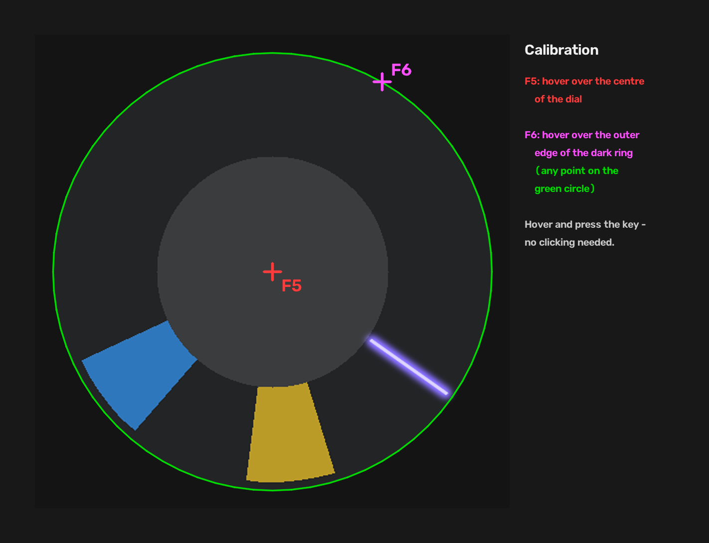

# Pick the Lock Bot


*Pick the Lock* minigame from the Dota 2 Dark Carnival event. A dial with a rotating
pick and shrinking target bars makes a compact, fast-moving test case for these techniques.

The program only looks at the screen. The dial is captured with DXGI desktop duplication, the pick and
the yellow/blue bars are found with OpenCV, and a normal mouse click is sent when the pick will be on a
bar at the moment the game registers it. Nothing hooks into Dota or Steam, and no game memory is read
or modified.

> [!IMPORTANT]
> This repository is provided **for educational purposes only**, to explore Python, DXGI and OpenCV.
> It is not intended to give anyone an unfair advantage, and you are responsible for how you use it.
> Automating gameplay may break the Dota 2 / Steam terms of service; use it at your own risk.
>
> This project is not affiliated with, endorsed or sponsored by Valve Corporation. Dota 2 and Steam are
> trademarks of Valve Corporation. No game files are included. The only game-derived data are tiny
> binarized digit templates (16×24 pixels) used to read the on-screen timer; the image in `docs/` is
> drawn by the project's own simulator.

## What you can learn from the code

- DXGI desktop duplication (via [dxcam](https://github.com/ra1nty/DXcam)) with an
  [mss](https://github.com/BoboTiG/python-mss) fallback
- Polar unwrapping of a circular region (`cv2.warpPolar`)
- Background modelling and motion detection
- Colour segmentation in HSV that stays robust for fading, translucent objects
- Template-matching OCR for an on-screen timer
- Tracking with outlier rejection and velocity estimation
- Learning the input-to-display latency from visual feedback
- A small look-ahead planner, tuned with Monte Carlo simulation

## Requirements

- Windows 10 or 11
- Python 3.14 (only to run from source or to build the exe)
- Dota 2 in **Borderless Window** mode (recommended)

## Getting started

Run from source:

```bat
py -3.14 -m venv .venv
.venv\Scripts\activate
pip install -r requirements.txt
python picklock.py
```

Or build a standalone exe:

```bat
build.bat
```

`PickTheLock.exe` is written to the repository root, next to `config.json`. The build uses the `.venv`
environment when it exists.

## Calibration

Done once. Open the minigame, then:

1. Hover the mouse over the **centre** of the lock dial and press <kbd>F5</kbd>.
2. Hover over the **outer edge of the dark ring**, where a yellow bar ends, and press <kbd>F6</kbd>.

You don't click, you only hover and press the key. The result is stored in `config.json` and reused on
every start. Recalibrate if the window size or resolution changes.



## Hotkeys

| Key | Action |
|---|---|
| <kbd>F5</kbd> | Calibrate the centre |
| <kbd>F6</kbd> | Calibrate the ring edge |
| <kbd>F7</kbd> | Start / stop (high beep = on, low beep = off) |
| <kbd>F8</kbd> | Debug view and recording on / off |
| <kbd>Del</kbd> | Quit |

The bot only clicks while the Dota 2 window is in the foreground. It holds the right mouse button
(speed boost) while it plays.

## Configuration

`config.json` holds the calibration, the learned latency per frame-rate profile, and any setting you
want to override. Only add what you want to change, for example:

```json
{
  "fps_profile": "30",
  "min_target_s": 0.03
}
```

All defaults are in `DEFAULTS` at the top of `picklock.py`. The most useful ones:

| Setting | Default | Description |
|---|---|---|
| `fps_profile` | `"auto"` | Timing profile, see below |
| `boost_mode` | `"always"` | `"always"` or `"off"`: hold the right mouse button (speed boost) |
| `strategy` | `"plan"` | `"plan"` or `"greedy"` (clicks every bar it reaches) |
| `points_per_second` | `1600` | Value of the time a blue bar adds |
| `min_target_s` | `0.025` | Skip bars the pick crosses faster than this; raise it if thin bars get missed |
| `click_blue` | `true` | Set to `false` to ignore blue bars |
| `yellow_hue`, `blue_hue` | `[14, 30]`, `[98, 112]` | Colour ranges, if bars aren't detected |

The bot sees the minigame as often as Dota redraws it (`fps_max_ui`), and `fps_profile` matches its
timing to that:

| `fps_profile` | Use with |
|---|---|
| `"auto"` | Default. Picks one of the profiles below from the measured frame rate. |
| `"120"` | `fps_max_ui` 120 or higher. Most precise. |
| `"30"` | `fps_max_ui` 30. Works, with slightly fewer hits per game. |

Below about 25 fps the hit flash is often not drawn at all, so avoid that.

## Debugging and developer tools

While running, the console shows a status line:

```text
[ON ] fps=164.8/120 pick= 182.3 w=  127 bars(y/b)=2/1 lat=21.4ms timer=17.3 clicks=12 hits=12 miss=0
```

| Field | Meaning |
|---|---|
| `fps` | Frames per second / active profile |
| `pick`, `w` | Pick angle and its speed in deg/s (about 127 with boost) |
| `bars(y/b)` | Yellow / blue bars currently detected |
| `lat` | Learned click-to-game delay |
| `timer` | TIME REMAINING as read from the screen |

<kbd>F8</kbd> writes `recordings/rec_<time>.mkv` (lossless, about 1 GB per game), a `.csv` with what the
bot detected and did on every frame, and a `.json` with the settings in use. The tools run from the
repository root:

| Command | Purpose |
|---|---|
| `python -m tools.replay recordings/rec_<time>` | Replays a recording through the current code and saves an annotated frame for every click it would make. |
| `python -m tools.strategy_sim [games] [fps]` | Plays whole games against a model of the minigame fitted to real recordings. Use it to compare strategy settings before trying them in the game (60+ games, single games vary a lot). |
| `python -m tools.vision_sim [seconds]` | Renders a synthetic dial and runs the full detection and control pipeline on it, at 165 and 30 fps. |
